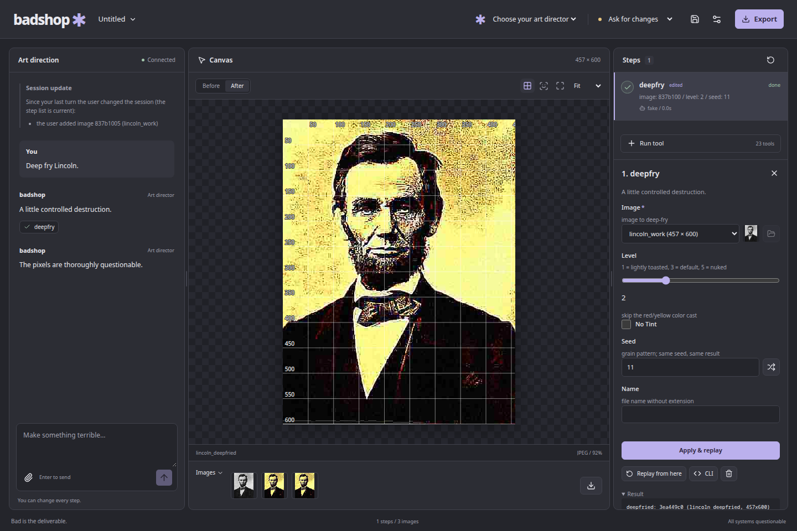

# badshop

A desktop app where any vision-capable LLM makes deliberately bad, 2005-forum-style
photoshops — hard-edged cut-and-paste, Impact captions, laser eyes, deep-frying — while
you watch every step, edit its parameters, run tools yourself, or approve each call.



The desktop app, deterministic engine, model providers, terminal client, and MCP bridge are
implemented. The app keeps every edit as an inspectable step: change parameters, replay from
an earlier step, or run the same tools manually. Models direct the tools; image-generation
models never produce the pixels.

## Desktop

Build from source until the first release is published:

```sh
uv sync --project core --locked
pnpm --dir app install --frozen-lockfile
pnpm --dir app tauri dev
```

Development needs Python 3.12, uv, Node 22, pnpm 10, Rust, and Tauri's native libraries.
See [build and release instructions](docs/releasing.md) for prerequisites and standalone
installers. Release targets are Linux x86-64 (deb, AppImage, Flatpak), Windows x86-64 (NSIS),
and Apple Silicon macOS 14+ (dmg). Windows/macOS runtime checks run on their CI hosts; releases
also need the [live validation checklist](docs/releasing.md#release-checks-needing-actual-environments).

On first launch, add a provider in Settings or use the tools manually. Import an image with
the file picker, drag-and-drop, or clipboard. The three panes show conversation, image, and
editable steps. Use the tool palette for manual edits, click/drag image coordinates into
forms, compare before/after, and export the selected image. Projects use `.badshop` files;
autosave recovery is offered after a previous run and restored automatically after a core
restart. Diagnostics, appearance, tool limits, and cancellable model downloads live in Settings.

Save with Ctrl/Cmd+S; use Ctrl/Cmd+Shift+S for Save As and Ctrl/Cmd+O to open a project.
The dot beside the session name marks unsaved changes. Opening, creating, restoring, or
closing a session offers Save, Discard, and Cancel; canceling a file picker keeps your work.
Autosave is crash recovery and does not replace saving a project file. Drag a pane divider
or use its arrow keys to resize; double-click a divider to reset the layout.

Choose an API provider, a local OpenAI-compatible vision server, or an authenticated Claude
Code/Codex CLI. Gemini CLI support is experimental and requires a recent version with
streaming JSON and resume support. Subscription CLIs use a private MCP configuration and
badshop's approval gate. Models without native tool calls use a validated JSON fallback,
with a capability warning. API keys use the system keychain or a named environment variable.

The default cutout model is u2net. BiRefNet is optional and needs much more RAM: the Linux
measurement peaked at 9,328 MiB on a 1000-pixel image. Set Tool memory to at least 12,288 MB
for BiRefNet and allow headroom for the rest of the app. Results vary by platform.

See the [design](docs/superpowers/specs/2026-09-26-badshop-app-design.md),
[implementation record](docs/superpowers/plans/2026-10-31-complete-app.md), and
[model licences and attribution](docs/model-licenses.md).

## Running the command line

`core/` holds the Python package (`core/src/badshop/`: `engine/`, `tools/`, `cli/`,
`session/`, `agent/`, `server/`), managed with [uv](https://docs.astral.sh/uv/). Run the
CLI from the folder that holds your images, since relative paths and the `badshop_work/`
folder resolve against it:

```
uv run --project /path/to/badshop/core badshop prep photo.jpg
uv run --project /path/to/badshop/core badshop --help      # every command
```

Or install it once as a tool (from the repository root) and drop the prefix:

```
uv tool install ./core
badshop prep photo.jpg
```

A bare `uv run badshop …` works only inside `core/`. Finished images go to
`~/Pictures/badshop/` (or `$BADSHOP_OUT`); downloaded models and fonts go to the app data
folder (or `$BADSHOP_DATA_DIR`). Tests: `cd core && uv run pytest -q`.

`reference/` holds the working CLI engine this app is built from (`badshop.py`, the
Claude Code skill that drives it, and a generated catalog of every tool and parameter).

## Running the core

`badshop-core` is the headless core the desktop app talks to: it holds the session (images,
steps, replay, project files) and runs the tools and the agent.

```
uv run --project /path/to/badshop/core badshop-core serve
```

(`python -m badshop.server serve` in the project's environment does the same.) It listens on
127.0.0.1 only, on a free port (`--port N` picks one), and prints exactly one line to stdout,
`{"port": 40123, "token": "<a random token>"}`; everything else goes to stderr. A client connects to
`ws://127.0.0.1:<port>` and first sends `{"type": "hello", "token": "<token>", "actor": "user"}`.
The core answers `{"type": "welcome", "actor": "user", "version": "0.1.0"}`; any other first
message (or none within 10 s) closes the connection with code 1008. After that it is JSON-RPC
2.0 in text frames: requests such as
`{"jsonrpc": "2.0", "id": 1, "method": "tools.list", "params": {}}`, and events
(`step.finished`, `approval.needed`, `turn.finished` and the rest) as notifications. The
methods and events are listed in spec §7 and `core/src/badshop/server/app.py`. Requests run
concurrently, so match replies by `id`; messages can be up to 64 MiB, so raise your client's
limit (websockets' default is 1 MiB). Closing the connection cancels the requests it is still
waiting on. Ctrl-C or SIGTERM stops the core cleanly: clients get close code 1001, a running
tool and the agent's turn stop, and the session is autosaved. When stdin is not a terminal, the
end of stdin does the same: the app starts the core with a stdin pipe, so a core whose app has
died stops too. When you script it, keep its stdin open: with stdin from `/dev/null` (which a
background job in a script gets) it stops right after the handshake line.

For offline demos and tests without a selected provider, `chat.send` can play a script: point
`BADSHOP_FAKE_PROVIDER` (or the `fake_provider_script` setting) at a JSON list of replies such
as `[{"text": "Looking for faces.", "tool_calls": [{"name": "find", "arguments": {"image": "a3f9c1d2"}}]}]`.
Settings live in the config folder (`$BADSHOP_CONFIG_DIR` overrides it), and the open session
autosaves to `autosave/session.badshop` in the data folder. On the next start the core sets that
file aside as `autosave/previous.badshop` and offers it: `session.get` reports its path as
`restorable`, and `session.restore` opens it (spec §9).

## Terminal chat and providers

From the repository root, choose a vision model:

```sh
uv run --project core badshop chat --model openai/YOUR_MODEL --api-key-env OPENAI_API_KEY --image photo.jpg
```

Set the named environment variable before launching; its value never goes in a project or
profile file. For a local OpenAI-compatible vision server whose model is absent from the
capability catalogue:

```sh
uv run --project core badshop chat --model openai/YOUR_LOCAL_MODEL \
  --api-base http://127.0.0.1:1234/v1 --supports-vision --supports-tools --image photo.jpg
```

Only enable overrides for capabilities your model actually supports. The terminal streams
replies, asks before image-changing calls, and accepts `y` (approve), `n` (reject), or `e`
(edit parameters as JSON). `/import PATH` attaches an image to the next request; `/save PATH`,
`/open PATH`, `/restore`, `/retry` and `/quit` manage the session. Ctrl-C stops and exits;
completed work is autosaved. `/retry` retries a provider failure without repeating finished
tools. Use `--approval-mode auto` to allow tools without prompts.

For Ollama, configure enough context for the tool catalogue, images, and conversation.
Its default 4,096-token window can reject even the first editing request. For example,
start your Ollama server with `OLLAMA_CONTEXT_LENGTH=32768 ollama serve`; longer sessions
may need more context and memory. This also applies when using Ollama's OpenAI-compatible
endpoint. See [Ollama's context configuration](https://docs.ollama.com/context-length).

`--model` creates a saved profile; reuse its ID with `--profile ID`. The local API exposes:

- `providers.list {}` and `providers.save {profile, api_key?}` (create or replace by ID).
- `providers.select {profile_id}` selects one for this session.
- `providers.delete {profile_id}` removes its profile and keychain credential.
- `providers.test {profile_id, probe?}` checks capabilities; `probe: true` also makes a
  provider request, which may incur API charges.
- `chat.retry {}` resumes the latest failed provider request in this core process.

Profiles contain `id`, `label`, `kind` (`api`, `local`, `openai_compatible`, or `cli`), LiteLLM `model`,
optional `api_base` and `api_key_env`, and optional boolean `capability_overrides`
(`vision`, `tool_calls`). `api_key_ref` is managed by the core. Supplying `api_key` stores
it through [keyring](https://keyring.readthedocs.io/en/stable/) in the OS keychain; an
unavailable keychain produces an error suggesting `api_key_env`, never plaintext storage.
Only user clients may manage profiles. Custom endpoints require explicit credentials when
authenticated; unrelated ambient cloud credentials are not forwarded to them.


CLI profiles set `kind: "cli"`, `cli: "claude" | "codex" | "gemini"`, and optionally an
absolute `executable` path. `providers.detect` reports installed CLIs and compatibility.
Authenticate the CLI separately before selecting it. The MCP bridge is also available as
`badshop-core mcp --connect ws://127.0.0.1:PORT --token TOKEN --actor cli:claude` for a core
that is already running. Treat the local connection token as a secret.

For Claude Code's standalone image-editing workflow, install `core` as a tool and copy
[`skills/badshop`](skills/badshop) into your skills directory. It calls the packaged `badshop`
CLI; `reference/` remains the original parity fixture.
