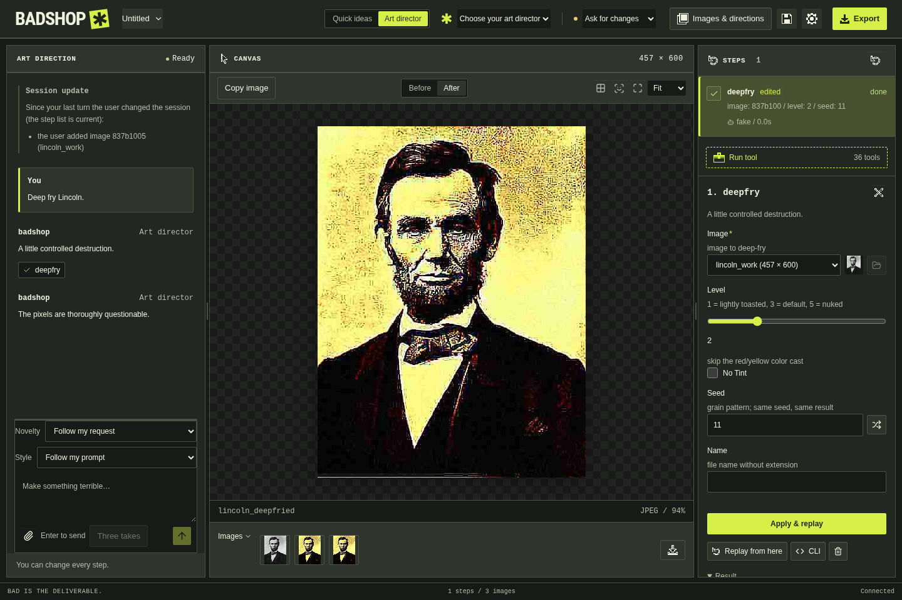

# BadShop

Make deliberately bad cut-and-paste photo edits: laser eyes, Impact captions,
deep-fried colors and all the charm of an old internet forum. Start with a ready-made
idea, run tools yourself, or let a vision model direct the edits. Every step stays
visible and editable in a replayable timeline.

**The engine makes the pixels.** AI is optional and chooses tools and parameters;
image-generation models never touch your pictures. Hard edges are part of the joke.

[Download the app](https://github.com/dan-wiseman94/BadShop/releases/latest) ·
[Start the dev stack](#start-the-dev-stack) ·
[Documentation](docs/README.md) · [Contribute](CONTRIBUTING.md)



*Source UI with a real Python core and a scripted demo assistant.
[Take the screenshot tour](docs/screenshots/README.md). Installed releases may have
older controls than this checkout.*

## Just want to use it?

Download an installer from [GitHub Releases](https://github.com/dan-wiseman94/BadShop/releases/latest).
The **Source code** archives are for development; they are not installers.

See [download choices](docs/downloads.md), [Windows setup](docs/windows.md) or
[macOS setup](docs/macos.md) for your platform. No developer tools or AI account are
needed to try Quick ideas and manual editing in the installed app.

## Start the dev stack

Run these commands from the repository root, the folder containing this README.
You need an internet connection for the first dependency downloads. The initial
Rust build can take several minutes; later launches reuse the build cache.

### 1. Install prerequisites

| Required | Purpose |
| --- | --- |
| Git | Clone the repository |
| Python 3.12 and uv | Run the image engine and local backend; uv can download Python when needed |
| Node.js 22 with npm | Run the frontend development server |
| pnpm 10, or Corepack | Install the locked frontend dependencies |
| Rust stable with Cargo | Build the native desktop shell |
| Native platform libraries and build tools | Compile and run the Tauri window |

Platform setup:

- **Linux:** GTK 3, WebKitGTK 4.1, OpenSSL, a C/C++ toolchain, `pkg-config`,
  the app indicator library and TBB. See [native prerequisites](docs/releasing.md#local-development).
  Install system packages with your distribution's package manager before launching.
- **Windows:** MSVC C++ Build Tools, the Windows SDK and WebView2.
  Follow [Windows source setup](docs/windows.md#run-from-source).
- **macOS:** follow [local development setup](docs/releasing.md#local-development),
  including the OpenSSL environment settings for Intel Macs. The app targets macOS 14+.

The launchers install project dependencies. They do not install system packages
or configure global package managers.

### 2. Clone and launch

```sh
git clone https://github.com/dan-wiseman94/BadShop.git
cd BadShop
```

**Linux / macOS:**

```sh
./start.sh
```

**Windows PowerShell:**

```powershell
.\start.cmd
```

On Windows you can also double-click `start.cmd` in File Explorer. If you already
have a checkout, use its folder and skip cloning.

Both launchers sync Python and frontend dependencies from the committed lockfiles,
then start the complete desktop development stack:

1. **Vite** serves the React interface at `http://127.0.0.1:1420`.
2. **Tauri** builds and opens the native app window.
3. **The desktop shell starts the Python core** on a separate local port and connects
   the interface to it automatically.

**Use the desktop window. You do not need to start the core separately.** Keep the
launch terminal open; it shows dependency, build and runtime errors. Close the app
or press **Ctrl+C** in that terminal to stop the development session.

### 3. Check that it works

Follow [Make your first edit](#make-your-first-edit) below. You can make and export
an image without configuring a provider or downloading an optional AI model.

### If startup fails

| Symptom | Next step |
| --- | --- |
| “Missing prerequisite” or command not found | Install the named tool, open a fresh terminal and rerun the launcher. |
| Native library, linker or SDK error | Check your platform's prerequisites above; Python and frontend installs alone are insufficient. |
| Dependency download fails | Check your connection and rerun the launcher; completed downloads are cached. |
| Port 1420 is busy | Close the other dev session. On Linux/macOS, use `BADSHOP_DEV_PORT=1422 ./start.sh` to choose another port. |
| App opens but the core fails | Keep the terminal output and see [support and diagnostics](docs/support.md). |

To inspect available tools and Linux native-library metadata:

```sh
./verify.sh doctor
```

On Windows:

```powershell
uv run --project core --locked python scripts/verify.py doctor
```

`doctor` reports prerequisites; it does not prove the app builds or runs.

## Make your first edit

1. Choose **Start with a quick idea**, pick a card, and edit its headline and punchline.
   Use the bundled pigeon or **Add my own image**, then click **Make this shitpost**.
2. Use **Change caption only** to revise the joke. To explore tools and the timeline,
   open **Art director / All tools**. Run an effect, select its History step, change
   parameters and replay it.
3. Use **Copy image** or **Export → Save image file** to share the result.
   The default export folder is **Pictures/badshop**; change it in
   **Settings → Preferences → Output folder**.
4. Save a `.badshop` project with **Ctrl+S** to keep the editable steps, then reopen
   it with **Ctrl+O**. On macOS use **Cmd**. Exporting an image and saving a project
   are separate actions.

Autosave offers recovery after an interruption. Save important projects explicitly.
Earlier installers may offer **Edit a photo without AI** instead of Quick ideas.

Continue with [the Quick idea tutorial](docs/tutorials/first-shitpost.md),
[manual tools and replay](docs/tutorials/edit-and-replay.md), or
[playful workflows](docs/playful-workflows.md) for reusable characters, reactions and remixes.

## Optional AI setup

Open **Settings → Providers** to configure a cloud API, a local vision server,
an OpenAI-compatible endpoint, or a supported CLI. For CLI providers, install and
sign in to the CLI separately before selecting it in BadShop. See
[provider requirements and compatibility](docs/compatibility.md) and
[AI art direction with approvals](docs/tutorials/art-director.md).

Quick ideas, manual tools and recipe replay use no model tokens. Cloud API calls
may incur charges; subscription CLIs use their own plan limits. Local providers
need a model and enough memory. API credentials use the system keychain or a named
environment variable. See [privacy and data flow](docs/privacy.md).

## Find your way around the code

| Path | What lives here |
| --- | --- |
| `app/src/` | React and TypeScript interface, forms and presentation state |
| `app/src-tauri/` | Rust desktop shell, native integration and core supervision |
| `core/src/badshop/engine/` | Deterministic pixel operations |
| `core/src/badshop/tools/` | Tool registry, parameter schemas and handlers |
| `core/src/badshop/session/` | Steps, artifacts, replay and project persistence |
| `core/src/badshop/agent/`, `providers/` | Art-direction loop and provider adapters, under the core package |
| `core/src/badshop/server/` | Authenticated local WebSocket API |
| `core/tests/`, `app/tests/`, `app/e2e/` | Python, component and browser workflow tests |
| `docs/` | Tutorials, current contracts, development and release guides |
| `reference/` | Original engine, art-direction skill and CLI tool catalogue |
| `packaging/` | Installer and bundled-core build tooling |

The Python core owns project state and tool execution. React renders that state;
Tauri handles the native lifecycle. Application tool calls pass through the session
so manual edits and AI edits share history, approvals and replay.
Read [architecture](docs/architecture.md) before changing those boundaries.

## Developing and testing

Read [AGENTS.md](AGENTS.md) and [contributing](CONTRIBUTING.md), then use
[the development guide](docs/development.md) to create an isolated task worktree
and choose checks for the behavior you change. Run commands inside that worktree;
keep its Python environment separate from other checkouts.

After the launcher's dependency setup, examples of focused checks are:

```sh
# Python: one affected test file.
./verify.sh python --python-test core/tests/test_sheets.py

# UI: one affected component test file.
./verify.sh component --component-test tests/session-actions.test.tsx

# Browser + real core: the manual-editing workflow.
./verify.sh browser --browser-test e2e/project-journey.spec.ts --test-name "manual editing"
```

Browser tests first need Chromium: `pnpm --dir app exec playwright install chromium`
(or `corepack pnpm@10` in place of `pnpm`). For Windows commands, test-layer limits
and private native testing, see [development and testing](docs/development.md).
Evidence belongs in `artifacts/verification/`. Documentation-only changes need no
application tests; full suites and installer builds are reserved for changes that need them.

## Running the command line

From the repository root:

```sh
uv run --project core --locked badshop --help
uv run --project core --locked badshop prep photo.jpg
```

Relative image paths and the `badshop_work/` directory resolve against your current
folder. To use `badshop` from any image folder, install it once from the checkout
with `uv tool install ./core`. The [tool catalogue](reference/tool-catalog.md)
describes the original CLI commands; `--help` shows the current command surface.
[The BadShop skill](skills/badshop) lets an external assistant direct the packaged CLI.

## Running the core

For backend-only work, start the local server without the desktop:

```sh
uv run --project core --locked badshop-core serve
```

It prints a port/token handshake and listens on loopback. Keep its stdin open:
closing stdin stops the core. The desktop launcher manages this connection for you.
See [processes and boundaries](docs/architecture.md#processes-and-boundaries) and
[server contracts](core/src/badshop/server/contracts.py) for integration work.

## More documentation

Start at [the documentation index](docs/README.md) for the full guide map.

- [Image discovery and the Junk drawer](docs/image-discovery.md),
  [layouts and packs](docs/layouts-and-packs.md), [local media](docs/local-media.md)
- [Project and provider compatibility](docs/compatibility.md),
  [model licences](docs/model-licenses.md), [privacy](docs/privacy.md)
- [Release builds and packaging](docs/releasing.md),
  [support](docs/support.md), [security reporting](SECURITY.md)
