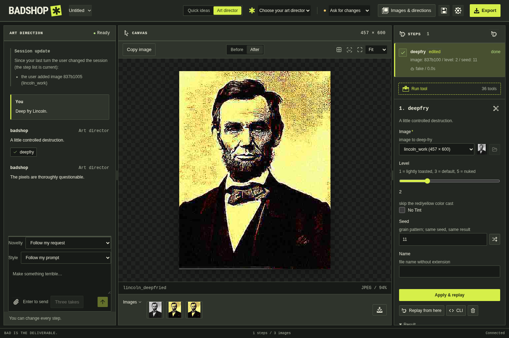

# badshop

Make deliberately bad photo edits in the style of an old internet forum. Add laser eyes,
an Impact caption, or a deep-fried color cast. Pick the effects yourself or tell a vision
model what you want. Every edit appears in a timeline you can change and replay.

## Get badshop on Windows

**[Download the latest badshop release](https://github.com/dan-wiseman94/BadShop/releases/latest)**

Open the downloaded setup file, follow the prompts, then launch **badshop** from
Start. The installer includes the image tools. In the release candidate, choose
**Start with a quick idea** for a ready-made shitpost without AI setup.

[Mac installation help](docs/macos.md) · [All downloads](https://github.com/dan-wiseman94/BadShop/releases/latest) · [Windows installation help](docs/windows.md)



## Make your first edit

1. Choose **Start with a quick idea**, pick a card, and edit the headline and punchline.
   Use the bundled public-domain pigeon or **Add my own image**. Click **Make this shitpost**.
2. Use **Change caption only** to fix the joke. **Keep this take & make a variant** keeps
   the original available under **Saved takes**. **Art director / All tools** opens the full editor.
3. For manual effects, choose **Run tool**, select **deepfry**, and run it. In History,
   select the step to compare Before/After or change its parameters and replay.
4. Use **Copy image** to paste into a chat, or **Export → Save image file**. Export shows
   a chat-sized preview and can save a separate credits file. The default export folder is
   **badshop** inside **Pictures**.
   To choose another folder, open **Settings → Preferences → Output folder**.
5. To keep editing later, press **Ctrl+S** and save a `.badshop` project. Reopen it with
   **Ctrl+O**. **Ctrl+Shift+S** saves a separate copy. On macOS use **Cmd** in place of **Ctrl**.

A dot beside the project name marks unsaved changes. If the app closes unexpectedly,
look for the recovery prompt the next time it opens.

Earlier installers may show **Edit a photo without AI** instead of Quick ideas.
See the [first-use and compatibility guide](docs/compatibility.md), [privacy](docs/privacy.md),
[support](docs/support.md), and [security reporting](SECURITY.md).

## Desktop

To run this source on Windows, install the [Windows build tools](docs/windows.md#run-from-source)
and double-click `start.cmd`. On Linux or macOS, install the
[development prerequisites](docs/releasing.md#local-development) and run `./start.sh`.
Both launchers prepare the locked dependencies and open the desktop app. Keep the terminal
open during use. The first run needs internet access and may take several minutes.

On Linux and macOS, use `BADSHOP_DEV_PORT=1422 ./start.sh` to choose another port.
Installer targets also include Linux x86-64 (deb, AppImage, Flatpak) and macOS 14+
(separate Intel and Apple Silicon disk images). See the [build and release guide](docs/releasing.md).

### Optional AI setup

Choose an API provider, a local OpenAI-compatible vision server, or an authenticated Claude
Code/Codex CLI. Gemini CLI support is experimental and requires a recent version with
streaming JSON and resume support. Subscription CLIs use a private MCP configuration and
badshop's approval gate. Models without native tool calls use a validated JSON fallback,
with a capability warning. API keys use the system keychain or a named environment variable.

The default cutout model is u2net. BiRefNet is optional and needs much more RAM: the Linux
measurement peaked at 9,328 MiB on a 1000-pixel image. Set Tool memory to at least 12,288 MB
for BiRefNet and allow headroom for the rest of the app. Results vary by platform.

See the [design](docs/superpowers/specs/2026-09-26-badshop-app-design.md),
[implementation record](docs/superpowers/plans/2026-10-31-complete-app.md), and
[model licences and attribution](docs/model-licenses.md).

## Developing and testing

In PowerShell, run these from the repository folder after Windows source setup:

```powershell
uv run --project core --locked python scripts/verify.py doctor
pnpm.cmd --dir app exec playwright install chromium
uv run --project core --locked python scripts/verify.py browser
```

On Linux (macOS can run `doctor`, `quick`, and `browser`):

```sh
./verify.sh doctor    # Check local tools and Linux desktop prerequisites
./verify.sh quick     # Core/frontend tests, lint, frontend build, Rust tests
./verify.sh browser   # Browser workflows against a real, isolated Python core
./verify.sh desktop   # Real Linux desktop + ./start.sh on a private Xvfb display
./verify.sh all       # Run every local verification layer
```

Results and logs are kept in `artifacts/verification/`; native runs also save screenshots,
and failed browser tests retain traces. Model downloads and live provider calls are separate.
See [development and testing](docs/development.md) for setup, acceptance criteria, isolated
worktrees, and the limits of each test layer.

## Running the command line

`core/` holds the Python package (`core/src/badshop/`: `engine/`, `tools/`, `cli/`,
`session/`, `agent/`, `server/`), managed with [uv](https://docs.astral.sh/uv/). Run the
CLI from the folder that holds your images, since relative paths and the `badshop_work/`
folder resolve against it:

For example, in PowerShell, substitute the path where you extracted the project:

```powershell
uv run --project "C:\src\badshop\core" badshop prep "My photo.jpg"
uv run --project "C:\src\badshop\core" badshop --help
```

Or install the command once from the repository root, then run it from your photo folder:

```
uv tool install ./core
badshop prep photo.jpg
```

On Linux and macOS, use your checkout path in place of `C:\src\badshop`.
Finished images go to the **badshop** folder inside **Pictures** by default. Windows uses
the Pictures location shown in File Explorer, including a redirected OneDrive folder.
Set `BADSHOP_OUT` to choose a different location. Downloaded models and fonts go to the
app data folder, which you can override with `BADSHOP_DATA_DIR`.

`reference/` holds the working CLI engine this app is built from (`badshop.py`, the
Claude Code skill that drives it, and a generated catalog of every tool and parameter).

## Running the core

`badshop-core` holds the desktop app's session and runs the tools and the agent.
To start it on its own, run this from the repository folder:

```
uv run --project core badshop-core serve
```

(`python -m badshop.server serve` in the project's environment does the same.) It listens on
127.0.0.1 only, on a free port (`--port N` picks one), and prints exactly one line to stdout,
`{"port": 40123, "token": "<a random token>"}`; everything else goes to stderr. A client connects to
`ws://127.0.0.1:<port>` and first sends `{"type": "hello", "token": "<token>", "actor": "user"}`.
The core answers `{"type": "welcome", "actor": "user", "version": "0.3.0"}`; any other first
message (or none within 10 s) closes the connection with code 1008. After that it is JSON-RPC
2.0 in text frames: requests such as
`{"jsonrpc": "2.0", "id": 1, "method": "tools.list", "params": {}}`, and events
(`step.finished`, `approval.needed`, `turn.finished` and the rest) as notifications. The
methods and events are listed in spec §7 and `core/src/badshop/server/app.py`. Requests run
concurrently, so match replies by `id`; messages can be up to 64 MiB, so raise your client's
limit (websockets' default is 1 MiB). Closing the connection cancels the requests it is still
waiting on. Ctrl-C or SIGTERM stops the core cleanly: clients get close code 1001, a running
tool and the agent's turn stop, and the session is autosaved. When stdin is not a terminal, the
end of stdin does the same: the app starts the core with a stdin pipe, so a core whose app has
died stops too. When you script it, keep its stdin open: with stdin from `/dev/null` (which a
background job in a script gets) it stops right after the handshake line.

For offline demos and tests without a selected provider, `chat.send` can play a script: point
`BADSHOP_FAKE_PROVIDER` (or the `fake_provider_script` setting) at a JSON list of replies such
as `[{"text": "Looking for faces.", "tool_calls": [{"name": "find", "arguments": {"image": "a3f9c1d2"}}]}]`.
Settings live in the config folder (`$BADSHOP_CONFIG_DIR` overrides it), and the open session
autosaves to `autosave/session.badshop` in the data folder. On the next start the core sets that
file aside as `autosave/previous.badshop` and offers it: `session.get` reports its path as
`restorable`, and `session.restore` opens it (spec §9).

## Terminal chat and providers

From the repository root, choose a vision model:

```sh
uv run --project core badshop chat --model openai/YOUR_MODEL --api-key-env OPENAI_API_KEY --image photo.jpg
```

Set the named environment variable before launching; its value never goes in a project or
profile file. For a local OpenAI-compatible vision server whose model is absent from the
capability catalogue:

```sh
uv run --project core badshop chat --model openai/YOUR_LOCAL_MODEL --api-base http://127.0.0.1:1234/v1 --supports-vision --supports-tools --image photo.jpg
```

Only enable overrides for capabilities your model actually supports. The terminal streams
replies, asks before image-changing calls, and accepts `y` (approve), `n` (reject), or `e`
(edit parameters as JSON). In Windows terminal chat, type `/import ` and paste the result
of File Explorer's **Copy as path** to attach a photo. `/save PATH`,
`/open PATH`, `/restore`, `/retry` and `/quit` manage the session. Ctrl-C stops and exits;
completed work is autosaved. `/retry` retries a provider failure without repeating finished
tools. Use `--approval-mode auto` to allow tools without prompts.

For Ollama, configure enough context for the tool catalogue, images, and conversation.
Its default 4,096-token window can reject even the first editing request. For example,
start your Ollama server with `OLLAMA_CONTEXT_LENGTH=32768 ollama serve`; longer sessions
may need more context and memory. This also applies when using Ollama's OpenAI-compatible
endpoint. See [Ollama's context configuration](https://docs.ollama.com/context-length).

`--model` creates a saved profile; reuse its ID with `--profile ID`. The local API exposes:

- `providers.list {}` and `providers.save {profile, api_key?}` (create or replace by ID).
- `providers.select {profile_id}` selects one for this session.
- `providers.delete {profile_id}` removes its profile and keychain credential.
- `providers.test {profile_id, probe?}` checks capabilities; `probe: true` also makes a
  provider request, which may incur API charges.
- `chat.retry {}` resumes the latest failed provider request in this core process.

Profiles contain `id`, `label`, `kind` (`api`, `local`, `openai_compatible`, or `cli`), LiteLLM `model`,
optional `api_base` and `api_key_env`, and optional boolean `capability_overrides`
(`vision`, `tool_calls`). `api_key_ref` is managed by the core. Supplying `api_key` stores
it through [keyring](https://keyring.readthedocs.io/en/stable/) in the OS keychain; an
unavailable keychain produces an error suggesting `api_key_env`, never plaintext storage.
Only user clients may manage profiles. Custom endpoints require explicit credentials when
authenticated; unrelated ambient cloud credentials are not forwarded to them.


CLI profiles set `kind: "cli"`, `cli: "claude" | "codex" | "gemini"`, and optionally an
absolute `executable` path. `providers.detect` reports installed CLIs and compatibility.
Authenticate the CLI separately before selecting it. The MCP bridge is also available as
`badshop-core mcp --connect ws://127.0.0.1:PORT --token TOKEN --actor cli:claude` for a core
that is already running. Treat the local connection token as a secret.

For Claude Code's standalone image-editing workflow, install `core` as a tool and copy
[`skills/badshop`](skills/badshop) into your skills directory. It calls the packaged `badshop`
CLI; `reference/` remains the original parity fixture.

## Better material, more directions

**Images & directions** adds preview-first image discovery, purpose/pose/expression hints,
same-subject Commons searches, near-duplicate filtering, and additional museum and archive sources.
Import only the candidates you want. Keep recurring heads, props, and backgrounds in the persistent
**Junk drawer**, and save alternate editable timelines as **Branches** inside a project.

The chat composer offers six composition styles and **Three takes**. The art director inspects
recognizability, caption fit, and joke readability while retaining badshop's rough cut-and-paste style.
See [image discovery and reusable assets](docs/image-discovery.md), the optional
[browser helper](browser-extension/README.md), and [creative evaluation](docs/creative-evaluation.md).

The next material tools are also available in **Images & directions**:

- **Layouts & packs**: sixteen deterministic layouts with editable slots, plus eight original period
  decoration packs and portable `.badpack` import/export.
- **Clips, pages & folders**: select video/GIF frames, crop PDF/scanned-page regions, and search
  explicitly indexed local image folders. Video uses installed FFmpeg; PDFs use installed Poppler.
- **Image pairs**: compare subject/background combinations and compose a chosen pair as an editable
  paste step.
- **Sprite sheets**: extract selected cells from regular image grids, preserving transparent padding
  and editable row, column, margin, and gap settings.
- **Idea mixer**: mix joke, setting, era, and format into six briefs; lock favorite choices and add a
  selected brief to your chat draft, or prepare a source search.
- **Recent choices**: inspect local visual history; the chat's **Novelty** selector can change format,
  setting, era, or avoid recent sources without replacing explicitly supplied subjects.

Smithsonian, Biodiversity Heritage Library, and Europeana adapters extend discovery when their keys
are configured. See [layouts and packs](docs/layouts-and-packs.md),
[local media](docs/local-media.md), [collections and pairing](docs/collections-and-pairing.md),
and [novelty controls](docs/novelty.md).

Cleveland Museum of Art and Wellcome Collection work without API keys. **Collection availability**
shows which sources are configured and the environment variable needed for others. See
[open collections](docs/open-collections.md), [sprite sheets](docs/sprite-sheets.md), and
[idea mixer](docs/idea-mixer.md).
