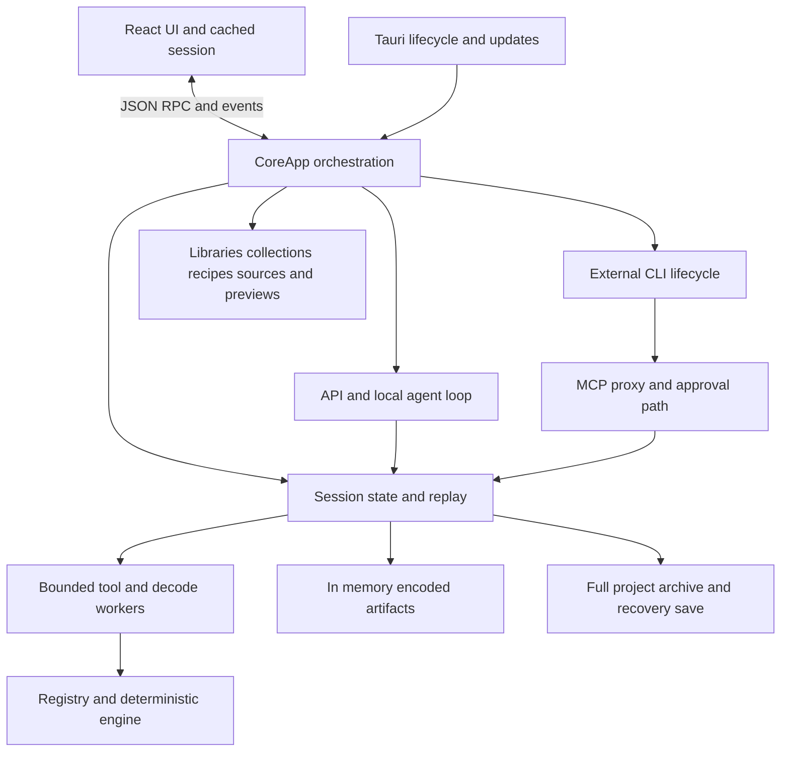
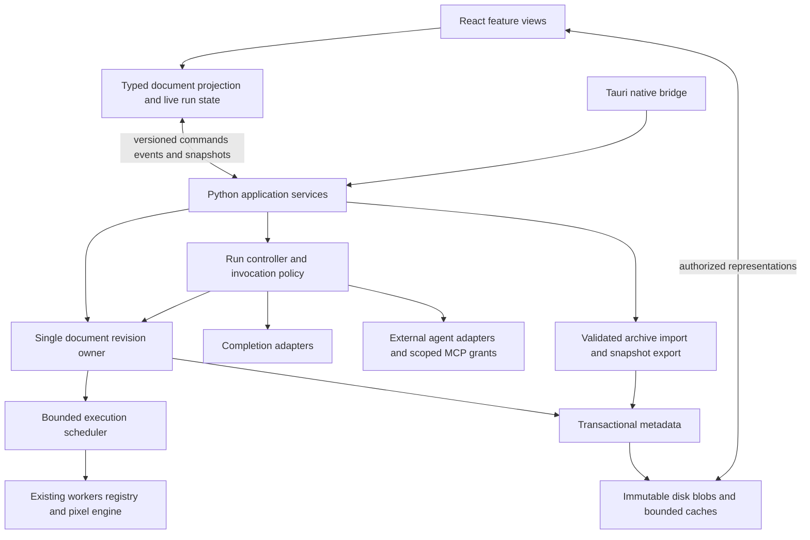

# BadShop architecture audit and long term direction

**Audit date:** 13 November 2026, America/Chicago. **Audited source:** [`fb1ad675546bd466d5578fbf324a72361458a619`](https://github.com/dan-wiseman94/BadShop/tree/fb1ad675546bd466d5578fbf324a72361458a619), the fetched `origin/main` at the start of this task. **Status:** assessment and proposed work; no application behavior changed.

BadShop should keep its deterministic Python engine, schema-driven tools, React interface and Tauri shell. Its long-term health does require substantial restructuring: make the editable document an explicit graph of versioned operations and named outputs; put live project metadata in transactional local storage with immutable disk-backed image blobs; unify execution ownership across manual tools, recipes, API agents and external agents; and give the UI a typed, revision-aware protocol with bounded media delivery.

The main problem is not the language selection. The application has grown beyond a small, mostly linear AI session controller into a local creative workshop with manual correction, branches, recipes, reusable characters, libraries, previews, remix packages, challenges and creation animations. Its state model still makes many of those features reconstruct relationships from a linear step list, image hashes, copied conversation histories and shared mutable services. Replacing that model is justified by current callers, not hypothetical future scale.

The recommendation is a staged internal redesign, not a simultaneous rewrite. Fix concrete defects first; establish contracts and measurements; replace the document, operation and persistence boundaries; then remove the old paths. The existing pixel engine and meaningful regression corpus remain the reference throughout.

## How to read the audit

This document gives the architectural judgment, cross-cutting findings, external comparisons and decision record. The implementation plan is [Architecture modernization plan](superpowers/plans/2026-11-13-architecture-modernization.md). Detailed subsystem evidence is in:

- [Core, artifacts, replay and persistence](audits/2026-11-13/core-and-persistence.md).
- [Agent, provider and MCP architecture](audits/2026-11-13/providers-and-agents.md).
- [UI, desktop platform and delivery](audits/2026-11-13/ui-platform-and-delivery.md).

The appendices are part of this audit, not optional supporting summaries. They contain the concrete code paths, failure sequences, proposed contracts and focused acceptance checks behind the recommendations below. Code citations are pinned to the audited commit so future refactoring does not silently change their meaning.

## Scope and confidence

The original checkout was clean at `0986dbda4059bb3ad81d358a71e8126a8e00d684`. It was behind merged main, including the latest persistence simplification and playful workflow work. The audit therefore used a managed isolated worktree at the newer revision. Other local worktrees contain unmerged work, including a substantial complete-creation workflow touching manual controls, artifacts, branches, persistence and the UI. Those edits were inventoried by the task helper but are not represented as merged behavior here. Reconcile this plan against them before implementation.

The review covered every major runtime and delivery domain: product requirements; engine/tools; import/decode; artifacts and provenance; replay/cache; branches/undo; session persistence and recovery; source discovery; local media and collections; libraries/packs/remix; recipes/challenges; API/local/CLI providers; context and approvals; MCP; local RPC; UI state/forms/viewer/chat/themes/accessibility; Rust lifecycle; updates; packaging; CI; dependency/license controls; verification; diagnostics; and contributor workflow. It traced selected critical and failure paths deeply. It is not a formal proof that every line or possible interleaving is correct.

Evidence labels used throughout:

| Label | Meaning |
| --- | --- |
| Confirmed source behavior | The behavior follows directly from the inspected implementation or explicit existing tests. |
| Focused reproduction | A small fault-injection or parser probe demonstrated the stated mechanism; its limits are stated. |
| Architectural risk | A concrete failure or scaling mechanism is present, but the end-to-end outcome/frequency has not been measured. |
| Proposed target | A design or acceptance objective, not a claim about existing performance. |

No full application suites, Linux/native runs, installed-package runs or live provider calls were performed for this documentation task. The new worktree had no application virtualenv. Two dependency-free probes executed unchanged extracted Python method bodies to verify decoder reassignment and partial-export behavior. A PowerShell parser probe verified invalid quoting without executing the copied command. These are narrower than application integration tests. Existing test files and historical evidence were reviewed, not relabeled as new passing runs.

Acceptance for the audit itself is source-linked findings, clear confidence, primary-source comparisons, explicit alternatives, a sequenced migration plan, data compatibility/rollback treatment, and no production modifications. Reproduction scripts, source inventory, document validation and task records are retained under `artifacts/verification/` in the audit worktree.

## What is currently built

The source inventory counted physical lines, including comments and blank lines, with tracked files only. It is a scope measure, not a quality score or refactoring target. Frontend totals include CSS and generated TypeScript; test rows include fixtures/helpers with the listed extensions.

| Area | Files | Physical lines |
| --- | ---: | ---: |
| Python runtime, `core/src/**/*.py` | 101 | 16,408 |
| Frontend runtime, `app/src/**/*.{ts,tsx,css}` | 55 | 12,646 |
| Rust runtime, `app/src-tauri/src/**/*.rs` | 6 | 1,242 |
| Python test code | 78 | 16,819 |
| Frontend component test code | 24 | 1,847 |
| Browser test code | 26 | 3,598 |
| Development/delivery Python and workflow YAML | 49 | 5,393 |

The roughly 30,000 lines in the three runtime areas are still manageable as a modular monolith. There is no evidence here that microservices, a large dependency-injection framework or a distributed workflow service would help.

The broad ownership design is sound. The trouble lies inside the large boxes and in the contracts between them. `CoreApp` has accumulated connection, settings, policy, provider, approval, checkpoint, persistence, task and service ownership. `Session` is both document behavior and infrastructure configuration. Feature modules register endpoints against an unrestricted `app` object and reach through its private state. The UI holds an authoritative-looking Session-shaped cache and merges largely untyped events into it. Those patterns make adding a feature easy initially and reasoning about interaction between features increasingly difficult.

## Fit for purpose

The original September spec explicitly describes a controller rather than a conventional image editor. Current guides describe a useful manual-first workflow: make a joke from your own images, adjust it, reuse a character or recipe, share the result, and reopen it later. AI is optional. This evolution is legitimate; the architecture should acknowledge it instead of treating every creative feature as an exception to the original chat session.

The architectural unit should be the **creative document**, not the provider conversation. A document contains source uses, operations, revisions, branches, selections needed for editing, provenance and reusable recipes. An agent run is one producer of document commands. A conversation is context for that producer. A library is a separate collection of reusable resources. A portable project/remix is a serialization of a selected document revision. These distinctions make the existing product simpler to explain and safer to evolve.

This does not imply brush editing, Photoshop-style blending, GPU generation, accounts or collaborative hosting. The hard-edge aesthetic, nearest-neighbor behavior and prohibition on image generation remain invariants. New manual controls should record deterministic operations over explicit inputs. If unrestricted painting, high-resolution layered design or live collaboration is ever desired, it should be a separate product decision with its own architecture evaluation.

There is no measured market-fit evidence in the reviewed study documents. They explicitly say that recruitment, first-use observation and retention work remain to be done. [Product validation](product-validation.md) and the [product study kit](product-study.md) also define different proposed activation thresholds and time windows. Consolidate those into one declared study protocol before drawing conclusions. Architecture should optimize for a completed, revisable, shareable joke and reliable return use; the number of tools or AI adapters is not the success metric.

## Preserve the strongest decisions

1. **The model directs; the engine produces pixels.** This narrow product constraint removes whole categories of complexity and gives BadShop a defensible identity. Preserve reference pixel behavior and seed handling.
2. **Application tool execution passes through the session.** Manual, API and MCP requests share observable execution. The standalone parity CLI has a documented direct runner/FileStore path; that is a legitimate distinct interface.
3. **The registry is a real shared contract.** It already feeds tools, forms, MCP and CLI generation. Expand metadata only where existing consumers currently guess semantics.
4. **Artifacts are immutable by encoded content.** Content hashes, original bytes and replayable parameters are excellent foundations. Separate logical identity/provenance around them rather than abandoning deduplication.
5. **Workers isolate expensive and native processing.** Time/RSS limits, cancellation and descendant cleanup are meaningful protections. Repair and strengthen them instead of moving all work back into the core.
6. **Recovery and archive validation have substantial defenses.** Atomic project save, bounded archive parsing, hash checks, strict path/compression handling, interrupted-step normalization and prior recovery protection are already implemented.
7. **Authority and privacy are explicit.** Actor-scoped credentials, approval policy, keychain handling, private CLI configuration, Local only transitions and restricted source fetching deserve preservation.
8. **Release evidence is unusually rigorous.** Signed updater artifacts, checksums, provenance, dependency/license inventories, exact-candidate acceptance and honest platform coverage distinctions already exist. A generic recommendation to add those would be inaccurate.
9. **Testing includes real outcomes.** Pixel/byte parity, real browser/core journeys, subprocess tests and private native workflows are more valuable than a larger count of shallow mocked assertions.

## Prioritized findings

Urgency means order of engineering attention, not an externally assigned vulnerability severity. The subsystem appendices contain exact code citations and fuller conditions.

| Priority | Finding | Evidence level | Consequence | First action |
| --- | --- | --- | --- | --- |
| Immediate | Branch validation constructs a Session against the shared artifact store and resets its bounded decoder to `None` | Source plus method-body reproduction, core C1 | Later image operations after reopen can lose the intended worker boundary | Pure branch validation; decoder lifetime owned by the store |
| Immediate | Export writes directly to the final filename and leaves partial bytes after a write failure | Source plus fault injection, core C2 | A failed output looks like a finished named image on disk | Non-overwriting staged publication and cleanup regression |
| Immediate | Same-version nightly engine changes do not necessarily change replay cache identity | Source, core C3 | Replay can reuse output from different implementation semantics | Build identity now; semantic tool/resource identities next |
| Immediate | Replaced persistent CLI providers are retired but kept alive until app close | Source, provider appendix | Repeated profile edits can retain processes/private directories | Explicit bounded retirement cleanup |
| Near term | UI listens for `step.done` where core sends `step.finished` | Source, UI-06 | Intended source-health invalidation misses agent operations | Fix and make event names generated discriminants |
| Near term | Copy CLI command uses POSIX quoting on PowerShell | Parser reproduction, UI-07 | Punctuation-containing commands fail for Windows users | Canonical argv plus shell-specific formatter |
| Foundational | Hashes act as blob IDs, artifact identity, provenance and inferred output edges | Source/design, core C5–C6 | Attribution and replay become ambiguous for equal bytes or changed output sets | Explicit artifact uses and named output references |
| Foundational | Automatic branches copy full histories twice per AI turn | Source/design, core C7 | Quadratic metadata growth can hit the 16 MiB project metadata limit | Shared immutable revisions and retention policy |
| Foundational | Encoded images stay in RAM; autosave rewrites full archives under the mutation lock | Source/design, core C8–C9 | Memory/disk work scales with retained history, not the current edit | Disk blobs and transactional metadata |
| Foundational | Events lack document incarnation, branch identity and revision/sequence ownership | Protocol risk, UI-02 | Delayed events/snapshots cannot independently prove they belong to the displayed document | Revision-aware envelope and delayed-delivery regression |
| Foundational | API and CLI loops duplicate tool policy and lifecycle | Source, provider appendix | Budget/rejection/retry semantics diverge | Shared run controller and invocation service |
| Foundational | Conversation history is persisted in an OpenAI-shaped dictionary format | Source/design, provider appendix | Provider protocol changes leak into document compatibility | Typed provider-neutral messages/calls/outcomes |
| High | Context has image limits but no complete token/text budget | Source/design, provider appendix | Successful long projects eventually overflow context | Budgeted deterministic context projection |
| High | Full session mutation/invalidation and eager lists/media dominate frontend update paths | Source scaling, UI-03–05 | Work grows with unrelated document content; latency is unmeasured | Separate projections/live state; indexed selectors; bounded media |
| High | Time, memory, events and subprocess bounds are local rather than whole-operation budgets | Risk, core C14/provider appendix | A nominally bounded worker/line can coexist with an unbounded turn or large IPC allocation | Operation admission, absolute deadlines, total resource accounting |
| Medium | Root rendering, dialogs and native diagnostics have weak failure containment | Source/risk, UI-08–10/SH-01–02 | One panel exception or noisy process can impair the whole cockpit | Recoverable boundaries, modal owner, bounded logs |
| Medium | Library/cache lifecycle and migration observability lag behind feature growth | Source/design, core C13 | Orphaned blobs, corruption and retained previews become maintenance burden | Reachability, quarantine, repair/compaction, diagnostics |
| Medium | Current release rigor is expensive to operate manually across targets | Operational risk, REL-01 | Cadence or support claims can outgrow maintainer capacity | Automate exact-candidate receipts and declare support tiers |

No evidence in this audit supports treating all of the table as observed production failures. In particular, delayed event corruption, worker IPC stalls and Windows shell-descendant leaks require targeted reproductions. Keep that distinction when creating issues.

## Cross cutting architectural diagnosis

### One writer is right; one lock for everything is too coarse

`CoreApp._blocking` correctly protects the non-thread-safe document and waits for a thread to finish even when its coroutine is cancelled. Do not remove that protection to make the UI appear faster. But the same path runs media extraction, collection work, image reads, mutation and recovery saves. A slow read or full archive rewrite can occupy the single lane. [Core blocking path](https://github.com/dan-wiseman94/BadShop/blob/fb1ad675546bd466d5578fbf324a72361458a619/core/src/badshop/server/app.py#L311), [media extraction caller](https://github.com/dan-wiseman94/BadShop/blob/fb1ad675546bd466d5578fbf324a72361458a619/core/src/badshop/server/media_api.py#L30).

The target is still one document commit owner. Validate and reserve a command, capture immutable inputs and an expected revision, execute bounded work outside the commit critical section, then validate ownership and commit a complete outcome. Reads use immutable snapshots or blob references. Provider waits and human approvals do not hold a database transaction. A new document/branch invalidates the old operation lease. Concurrency is introduced only after those rules exist.

Error responses also need to reflect the commit boundary. The generic RPC exception handler currently tells the user that the session is unaffected for any unexpected handler exception, even though the dispatcher itself supplies no rollback transaction. That is an unjustified generic guarantee, not evidence that every handler corrupts state. Replace it with typed pre-commit failure, committed failure or outcome-unknown information; only claim unchanged state when the owner can prove it. [RPC exception translation](https://github.com/dan-wiseman94/BadShop/blob/fb1ad675546bd466d5578fbf324a72361458a619/core/src/badshop/server/rpc.py#L136).

### Boundaries should be typed before files are split

Splitting `CoreApp` into twelve files while passing the same unrestricted object to all of them would preserve the problem. Current feature registrars use `app._blocking`, `app.session`, cancellation fields and private helpers directly; `Session` dynamically receives policy fields. These are examples of missing contracts, not evidence that every class needs an interface. [Media registrar](https://github.com/dan-wiseman94/BadShop/blob/fb1ad675546bd466d5578fbf324a72361458a619/core/src/badshop/server/media_api.py#L20), [retro registrar](https://github.com/dan-wiseman94/BadShop/blob/fb1ad675546bd466d5578fbf324a72361458a619/core/src/badshop/server/retro_api.py#L17).

Introduce explicit values for document identity/revision, operation context, execution policy and typed result. Then move current responsibilities behind narrow services. Start Python static checking at these boundaries, increasing strictness incrementally; do not convert the whole repository to a blanket `Any`-suppression exercise. Preserve the existing import-linter/Ruff restrictions and add contracts for the new ownership boundaries.

### The runtime format and portable format have different jobs

A ZIP is useful for moving a complete project. It is a poor incremental transaction log when every change rewrites image bytes. The live workspace needs small durable commits, indexes, resource references and recoverable operations. The portable archive needs self-contained bytes, versioned metadata, integrity checks and predictable export/import. Sharing logical schemas is useful; forcing both jobs through the same save operation is not.

SQLite metadata plus disk blobs is the preferred target, conditional on a small measured prototype. Use one authoritative store, not a database plus a second independent event store. A lightweight operation journal belongs in the same transaction. Keep portable `.badshop` archives and selective remix exports. SQLite has established atomic-commit and online-backup mechanisms, but WAL introduces checkpointing and same-host constraints; it is not a reason to put a live workspace database on arbitrary network/cloud-synchronized folders. [Atomic commit](https://www.sqlite.org/atomiccommit.html), [WAL tradeoffs](https://sqlite.org/wal.html), [online backup](https://www.sqlite.org/backup.html).

### Determinism must name its inputs

Seeded algorithms and hashed image bytes are necessary but insufficient to explain replay. Effective parameters also depend on tool semantics, runtime/codec versions, resolved fonts/models and captured remote results. A complete execution fingerprint should name these inputs. Opening saved pixels, replaying an old operation, upgrading an operation, and refreshing a remote search are four different actions.

Old pixels should remain visible when an optional tool or model is unavailable. Inspection and export should degrade gracefully where the archive is structurally valid, instead of requiring every historical tool to be runnable. This is a forward-compatibility improvement, not permission to execute unknown operations or accept malformed archives.

### Product state must be separate from presentation and provider state

An immutable document revision is not a streaming message buffer. A provider continuation token is not a document command. A thumbnail is not an authoritative artifact. An automatic undo checkpoint is not a named creative branch. Current overlap between those concepts is the source of substantial copying and exceptional logic.

The UI should maintain a normalized, disposable view of committed document state; transient run/progress/approval state lives alongside it. Providers consume bounded projections and return typed proposals. The authoritative document remains in Python. This allows React Query and Zustand to remain useful without a second project model.

### Process isolation and network policy must remain honest

The tool worker is a crash/resource boundary, not an OS sandbox. An actor credential is protocol authority, not protection against arbitrary same-user malware. CLI flag restrictions and private configuration reduce tool exposure, but version discovery is not a behavioral proof. A Flatpak with home/network access is not strict confinement. These limitations are already partly documented and should stay visible in compatibility/support promises.

Process-global download hooks are another explicit constraint: `assets.URL_POLICY`, `CONNECT`, `PROGRESS` and `CANCEL` are mutable globals, and `netpolicy.guarded` relies on one tool call per process. More parallelism must not be added without replacing or isolating that ambient policy. Pass an explicit download/resource context at the orchestration boundary or maintain separate worker instances with fixed policy. [Asset hooks](https://github.com/dan-wiseman94/BadShop/blob/fb1ad675546bd466d5578fbf324a72361458a619/core/src/badshop/engine/assets.py#L31), [guarded policy](https://github.com/dan-wiseman94/BadShop/blob/fb1ad675546bd466d5578fbf324a72361458a619/core/src/badshop/session/netpolicy.py#L126).

### Trust boundaries and failure containment

The following is an architectural threat/failure model, not a new penetration-test result. The detailed appendices identify the implemented guards and exact source paths.

| Boundary | Current protection worth preserving | Remaining architectural work |
| --- | --- | --- |
| Untrusted project, pack or remix archive | Bounded parsing, member/path/compression checks, hashes and validation before activation | Pure validation with no service mutation; migration staging and read-only inspection of safe unsupported operations |
| Image/native decoder | Restricted formats and bounded decoder worker | Fix reopened-branch decoder ownership; account for core/IPC buffers as well as worker RSS |
| Search results, remote images and redirects | Public-address connection checks, redirect policy, bounded downloads | Explicit per-operation network context; preserve policy when adding concurrency |
| Provider text and tool arguments | Untrusted data context, schema validation, deterministic approval and session execution | Typed outcomes, complete context/response budgets, consistent API/CLI policy |
| External agent and MCP credential | Private configuration and actor-scoped token | Revocable document/run grants; verified built-in-tool restrictions for supported versions |
| Renderer and local RPC | Authenticated loopback connection, narrow native capabilities, CSP | Complete result validation, owner/revision envelopes, capability checks on any binary media endpoint |
| Credentials and diagnostics | Keychain/environment separation and redaction | Safe structured correlation/usage; bounded logs and deliberate opt-in sensitive support material |
| Model/font/runtime assets | Manifests, hashes and explicit downloads | Resolved resource identity in replay; safe unavailable/mismatched-resource behavior |
| Release/update supply chain | Locked dependencies, audits, inventories, signatures and exact-candidate acceptance | Automate evidence, verify real installed upgrade/rollback, plan separate OS publisher trust |
| Same-user local process or executable extension | Existing worker/actor boundaries are limited protections | Do not claim an OS sandbox; avoid arbitrary executable plugins without a separate capability/isolation design |

Security improvements should preserve useful offline work and explicit user choices. Do not turn every normal edit into an approval prompt, move private projects to a hosted service, or add telemetry in the name of diagnostics. The narrow deterministic tool surface is already a major advantage.

## Comparison with relevant projects

There is no single exact analogue. BadShop combines a desktop creative tool, a deterministic workflow engine and an agent cockpit. The comparison therefore uses adjacent projects for specific architectural properties. Their image-generation or coding features are not recommendations for BadShop. Facts below are supported by primary documentation; the lessons are this audit's inferences. These are design comparisons, not benchmarks of speed, reliability or popularity.

| Project | Relevant documented design | Lesson for BadShop | Limit on the analogy |
| --- | --- | --- | --- |
| ComfyUI | Workflow submission validates inputs, returns a prompt identity and queues execution; history/status and image retrieval have distinct routes. [Server API](https://docs.comfy.org/development/comfyui-server/comms_routes) | Give every operation stable identity and separate control messages from image delivery. | Do not adopt diffusion, arbitrary custom-node execution or a node canvas as the default user experience. |
| ComfyUI node model | Input metadata, outputs, change detection and validation are explicit node contracts. [Node properties](https://docs.comfy.org/custom-nodes/backend/server_overview) | Retain the registry; add named output ports and deliberate cache/change semantics. | Its extension compatibility tradeoffs are a warning against publishing a broad plugin ABI prematurely. |
| InvokeAI | Typed Pydantic invocations take explicit inputs, use an invocation context and return outputs. [Invocation architecture](https://invoke.ai/development/architecture/invocations/) | BadShop's registry direction is sound; make context and output identity equally explicit. | Do not import its generation/model orchestration or larger product scope. |
| Blender | Its dependency-graph design separates original data from evaluated data and updates dependent results. [Dependency graph design](https://developer.blender.org/docs/features/core/depsgraph/) | Separate editable intent, revision identity and derived pixels; invalidate actual dependents. | A full Blender-style graph evaluator is far more machinery than a serial 2D tool chain needs. |
| Krita | Layers retain independently editable elements before compositing the final image. [Layers and masks](https://docs.krita.org/en/user_manual/layers_and_masks.html) | Preserve logical element/output identity so edits do not depend on equal-byte hash inference. | BadShop does not need a brush engine, arbitrary blending or a general layer stack to gain that identity. |
| Zed and ACP | External-agent ownership differs from built-in inference; ACP negotiates versions/capabilities and defines prompt lifecycle messages. [Zed](https://zed.dev/docs/ai/external-agents), [ACP initialization](https://agentclientprotocol.com/protocol/v1/initialization), [prompt lifecycle](https://agentclientprotocol.com/protocol/v1/prompt-turn) | Separate completion and external-agent adapters; evaluate a negotiated protocol to reduce parser drift. | ACP alone does not prove BadShop-only tool access, safe image behavior or subscription compatibility. |
| OpenHands | Conversation lifecycle, event history and LLM normalization are explicit; the LLM boundary carries usage information. [Conversation](https://docs.openhands.dev/sdk/arch/conversation), [LLM](https://docs.openhands.dev/sdk/arch/llm) | Typed run records and safe usage metadata improve recovery and diagnostics. | Container workspaces, distributed agents and general coding permissions are unnecessary here. |
| Aider | Relevant repository context is selected under a token budget. [Repository map](https://aider.chat/docs/repomap.html) | Build a compact, budgeted view of relevant artifact dependencies and recent turns. | This is a context-selection analogy, not a proposal to add code retrieval. |
| Goose | Session permission modes and CLI permission integration are explicit. [Permission documentation](https://github.com/aaif-goose/goose/blob/main/documentation/docs/guides/managing-tools/goose-permissions.md) | Keep permission ownership consistent across provider types. | BadShop's deterministic tool metadata is a better fit than adopting general autonomous tool access. |

The mature pattern is explicit ownership, typed operations and intentional resource lifetimes. None of these comparisons establishes that BadShop should become a larger generic framework.

## Decisions on major rewrites and migrations

| Decision | Recommendation | Why | Evidence that could change it |
| --- | --- | --- | --- |
| Python engine versus Rust rewrite | Keep Python pixel algorithms; permit narrow native acceleration only after profiling | Mature parity tests and existing native libraries; identified scaling risks and ownership problems are largely in copying/persistence/orchestration | Measured hot path dominates user latency and a replacement preserves pixels and materially improves total cost |
| Tauri versus Electron | Keep Tauri; isolate and test native/WebView assumptions | Existing native integration and release investment are useful; a shell rewrite does not fix document semantics | A bounded prototype shows persistent WebView-specific failures dominate support and Electron improves total distribution/runtime cost |
| React versus another UI framework | Keep React | Work is driven by subscription breadth, data shape and eager rendering | Measured evidence of an unfixable framework constraint, not component size |
| Tauri/React versus Python-native Qt/PySide | Keep the existing UI; consider Qt only as a measured competing prototype if native interaction becomes the dominant product need | Reduces languages in application code, but replaces the forms/themes/interaction/test stack and introduces a different native runtime/deployment surface; document and worker boundaries are still necessary | Equivalent native accessibility, image interaction, startup, memory, packaging and maintenance measurements show a decisive lifetime advantage |
| Desktop versus browser-only/PWA | Keep desktop and the headless core | Local files, subscription CLIs, private inference and offline work are current requirements; a web-only product would need a local companion or a different product scope | Explicit demand for browser access and an accepted privacy/auth/hosting model |
| JSON archive as live state | Migrate to transactional local metadata plus disk blobs; retain ZIP portability | Removes repeated whole-project writes and enables indexes, revision commits and bounded RAM | Prototype fails crash/performance/maintenance acceptance; then use incremental file metadata/journal as a narrower fallback |
| Linear step history versus full node editor | Add explicit operation dependency graph under the existing timeline | Existing replay, branches, recipes and provenance require true edges | A separate product decision establishes that users need visual graph authoring |
| Raw provider dictionaries versus domain records | Migrate to typed domain conversation/run records | Provider formats currently leak into persistence and lifecycle | No substantial counterexample; keep minimal records and avoid a general agent framework |
| Bespoke CLI parsing versus ACP | Prototype one adapter behind the same contract | Potentially deletes protocol drift and custom lifecycle code | Must pass tool-isolation, image, approval, resume and cancellation matrix before adoption |
| LiteLLM versus direct SDKs | Keep behind a narrow completion adapter while measuring supported payload cost | Breadth has value; replacing it with many adapters could increase maintenance | A small supported-provider set plus measured dependency/frozen-runtime failures makes direct adapters demonstrably cheaper |
| RPC over loopback WebSocket versus all Tauri IPC | Keep local RPC for UI/headless/MCP; strengthen contracts and binary media path | Multiple real clients already need the core independently of Rust | A validated alternate transport reduces complexity while retaining headless and MCP workflows |
| Monolith versus services | Keep a modular single-user core | No multi-tenant, scale-out or remote collaboration requirement | A future explicit hosted/multi-user product requirement |
| Event sourcing | Use a transactional operation journal, not mandatory full event sourcing | Recovery/audit need durable outcomes, not reconstruction from every historic event | A demonstrated branching/undo requirement cannot be met by immutable revisions and normal tables |
| Plugin marketplace | Defer executable plugins; keep validated data packs/recipes | Current extensibility works through owned schemas and deterministic tools | A real extension author ecosystem with sandbox, ABI, compatibility and support ownership |

Tauri uses a native core/webview process model; Electron uses Chromium-derived main/renderer processes. Those are genuine tradeoffs, but this audit measured neither renderer's performance on BadShop. Any replacement decision needs the same native workflow and memory/startup measurements. [Tauri process model](https://v2.tauri.app/concept/process-model/), [Electron process model](https://www.electronjs.org/docs/latest/tutorial/process-model).

Qt for Python supplies the PySide6 bindings and has its own deployment workflows. A Python-heavy native application is a credible alternative, not a dismissed possibility; its benefit would need to outweigh replacing the existing frontend and still preserving a supervised worker/core boundary. A single source language does not itself produce a single deployment or lifetime model. [Qt for Python](https://doc.qt.io/qtforpython-6/index.html), [deployment](https://doc.qt.io/qtforpython-6/deployment/index.html).

## Proposed architectural destination

This diagram describes responsibilities, not a mandate for one class, process or package per box. Keep services in the same Python core unless fault containment or an existing external runtime requires a process. The graph is an internal document model; the timeline remains the main editing interface.

The crucial invariants are: every committed image reference resolves to durable bytes; every operation belongs to one document incarnation and revision context; every externally proposed tool passes one policy/approval/execution path; every event names its owner and order; every retained resource has an owner and budget; opening old work preserves its pixels without executing it; and migrations never silently overwrite the last usable copy.

## Work order and expected payoff

The detailed [modernization plan](superpowers/plans/2026-11-13-architecture-modernization.md) defines fifteen work packages with dependencies and acceptance. The recommended order is:

1. Repair demonstrated decoder/export/cache/CLI lifecycle defects and small protocol/quoting errors.
2. Record realistic workload baselines and current behavior contracts; add complete typed protocol ownership.
3. Introduce one run/invocation owner and stable document/operation/output identities.
4. Replace copied checkpoints and live full-archive persistence with shared revisions, transactional metadata and disk blobs.
5. Bound UI/media/context resource use and reorganize feature ownership around the new contracts.
6. Harden installed-platform lifecycle, automate release acceptance, and only then revisit payload/provider/shell alternatives with measurements.

This is multiple months of careful work for a single maintainer if undertaken in full, not a one-week cleanup. The plan includes provisional effort ranges, explicit stop conditions and useful intermediate releases. Immediate reliability fixes and protocol contracts can ship independently; a database migration should not hold them hostage. Conversely, splitting files or changing frameworks without fixing identity, commit boundaries and resource ownership would spend substantial effort while preserving the same failure mechanisms.

The best long-term outcome is a smaller set of enforceable concepts supporting the current playful workflow: one creative document, one operation policy, one authoritative commit path, immutable image bytes, bounded execution, portable projects, and adapters that stay at the edges.
