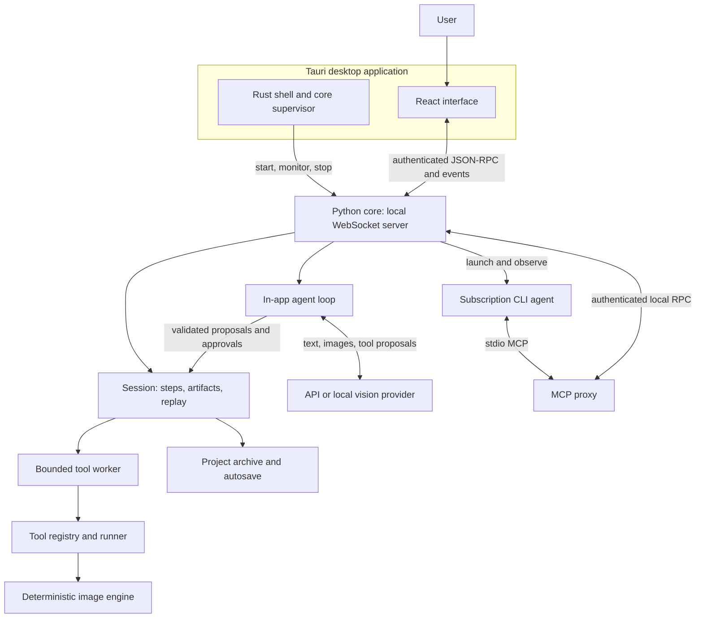

# Architecture

[Documentation](README.md) · [Development](development.md) · [Original design decisions](superpowers/specs/2026-09-26-badshop-app-design.md)

BadShop is a desktop controller around a deterministic image engine. React shows
the work, a Python core owns the project, and Tauri supplies the native application
lifecycle. A model may choose tools and parameters; it never generates or repaints
the image pixels. Hard edges and nearest-neighbor scaling are product rules.

This guide was checked against source revision `e4103cd` (0.4.3). The
[screenshot tour](screenshots/README.md#capture-notes) records its own capture
revision. The original spec contains early proposals and should be read as design
history where it differs. Consult the current [compatibility guide](compatibility.md)
for version-specific project formats.

## Processes and boundaries

The desktop has a shell and a core, with additional owned processes for tool
workers, subscription CLIs and optional local inference. The server binds to
loopback on a free port and requires a connection token. Its startup handshake
gives the shell the port and token; clients authenticate before making requests.
The MCP proxy forwards tool requests to that same core and does not own a project.

## Who owns what

| Responsibility | Implementation | Boundary |
| --- | --- | --- |
| Layout, selection, drafts and forms | [App.tsx](../app/src/App.tsx), [components](../app/src/components), [store.ts](../app/src/store.ts) | UI state; no second project model |
| Request lifecycle and cached core state | [rpc.ts](../app/src/rpc.ts), [data.ts](../app/src/data.ts) | Match replies by ID; reconcile snapshots and events |
| Shared serialized types | [server/contracts.py](../core/src/badshop/server/contracts.py), [wire.generated.ts](../app/src/wire.generated.ts) | Handler signatures own parameters; Python models own response/event schemas. The dispatcher and client validate the wire boundary. |
| Native dialogs, clipboard, startup and recovery | [native.ts](../app/src/native.ts), [Tauri library](../app/src-tauri/src/lib.rs), [supervisor](../app/src-tauri/src/supervisor.rs) | OS integration; no image algorithms |
| RPC dispatch, active session, turn and approval coordination | [server/app.py](../core/src/badshop/server/app.py), [ws.py](../core/src/badshop/server/ws.py), [rpc.py](../core/src/badshop/server/rpc.py) | Authenticate clients and serialize document mutations |
| Artifacts, steps, replay and persistence | [session/session.py](../core/src/badshop/session/session.py), [artifacts.py](../core/src/badshop/session/artifacts.py), [project.py](../core/src/badshop/session/project.py) | Authoritative project state |
| Schemas and tool dispatch | [tools/registry.py](../core/src/badshop/tools/registry.py), [catalog.py](../core/src/badshop/tools/catalog.py), [runner.py](../core/src/badshop/tools/runner.py) | Shared definitions for forms, model tools, MCP and CLI |
| Resource-limited execution | [session/worker.py](../core/src/badshop/session/worker.py), [execution.py](../core/src/badshop/session/execution.py) | Input bytes and validated parameters in; outcomes out |
| Image algorithms | [engine](../core/src/badshop/engine) | Pixel operations ported from [the reference engine](../reference/badshop.py), with deterministic expansion tools |
| Context and model protocol adaptation | [agent](../core/src/badshop/agent), [providers](../core/src/badshop/providers), [MCP proxy](../core/src/badshop/mcp/proxy.py) | Propose tools; keep image execution in the session |

Expansion catalogues register layouts, pairing, sprite sheets and retro tools
through the existing registry. Server modules for packs, local media and retro
features reuse the active session. The standalone `badshop` CLI also uses the
registry/runner and its file store; it does not require a running desktop session.
Terminal chat uses a session. See the [CLI entry points](../core/src/badshop/cli).

## One edit, from click to pixels

1. A user runs a tool, the in-app agent requests one, or a CLI calls it through
   MCP. The core validates parameters against the registered schema and resolves
   image references to artifact IDs.
2. The session records a proposed step with its actor, tool, parameters and inputs.
   Agent proposals pass through the approval policy before execution. Manual tool
   execution is the user's explicit action.
3. The session sends a `ToolCall` to its executor. The normal desktop worker
   isolates expensive tools and untrusted image decoding with time/memory limits.
   File-writing tools are handled in the session process so workers cannot choose
   arbitrary export destinations.
4. The runner invokes the engine. A `ToolOutcome` carries output bytes, result
   text, structured data or an error. The session imports successful outputs as
   immutable artifacts and finishes the step.
5. Core events update the timeline, viewer and chat. Autosave records recovery
   state. A failed step remains visible; it is not presented as a successful image.

Tool status and UI connection/turn status are separate. A connected socket is
not proof of a completed edit. Stop cancels owned work and keeps completed steps.
The [state-machine ledger](state-machines.md) describes cancellation and recovery
failure scenarios in detail.

## Artifacts, editing and replay

An artifact ID is the SHA-256 hash of its encoded bytes. Metadata records its
dimensions, format, label, producing step and any available source attribution.
Imports retain original bytes for provenance and create an upright working copy,
normally at most 1,000 pixels on the longest side. Tool coordinates refer to that
working image, not the full-resolution original.

Steps reference artifact IDs rather than mutable filenames. Editing a completed
step marks dependent work stale. Replay runs from that point and remaps later
inputs from the old outputs to the new ones. It can reuse a successful cached
result when its key matches and its outputs still exist. File-writing tools are
excluded from that cache: replaying an export must actually write a file.

Random operations record seeds. Repeating the same inputs and parameters in the
same dependency environment gives reproducible work; do not promise byte-identical
output across arbitrary encoder or runtime upgrades.

Branches keep alternate editable timelines in a project. The Junk drawer is a
separate persistent asset library for reuse across projects. Creative preferences
and recipes build on these existing session structures, rather than introducing
another image execution path.

Manual correction previews render a draft without adding project artifacts or
changing the timeline. Applying a correction uses the normal session/replay path.
Effect bypass redirects dependent steps through the effect's input; enabling it
restores the effect. Pins protect recorded source, wording or placement choices
by requiring approval for later AI operations on the protected result or its
descendants, even in Auto mode. Turn checkpoints support undo and editable copies.
See [manual corrections](manual-controls.md) for the controls and their limits.

## Project storage and recovery

A `.badshop` file is a ZIP archive containing `session.json`, referenced artifact
files under `artifacts/`, and `recipe.json`. Its schema number determines whether
this app version can open it; newer unsupported schemas are rejected. The supported
version is defined in [session/models.py](../core/src/badshop/session/models.py)
and documented in [compatibility](compatibility.md#project-compatibility-and-recovery).
The loader validates archive entries, resource
limits, artifact hashes, image decoding and project data before replacing the
active document. Saves use atomic replacement to protect the last good file.

| Stored data | Location/owner | Included in a project? |
| --- | --- | --- |
| Chat, steps, referenced images, branches, correction controls, checkpoints and project creative settings | Session archive | Yes |
| Recovery copy | App data `autosave/session.sqlite`, `previous.sqlite` and shared `blobs/` | Local recovery; explicit Save still exports a portable archive |
| Provider profiles and application settings | Config directory | Credentials are not embedded |
| Provider/source secrets | OS keychain or named environment variables | No |
| Models, fonts, reusable assets and local caches | App data directory | Separate from the project; referenced project images are retained |
| Exported images and optional credits | Chosen output folder; Pictures/badshop by default | Separate deliverables |

`BADSHOP_DATA_DIR`, `BADSHOP_CONFIG_DIR` and `BADSHOP_OUT` allow isolated storage.
Tests set private locations and never borrow the user's settings or credentials.
Autosave is recovery, not an explicit project save. See [privacy](privacy.md) and
[project compatibility](compatibility.md#project-compatibility-and-recovery).

Encoded images live in immutable temporary disk blobs during a session. Preview
forks own separate directories and retain independent links to their inputs.
Dropping an artifact removes its owned file; releasing a store removes its scratch
directory. No long-lived dictionary retains every encoded image as Python bytes.

Recovery publishes hash-verified blobs before committing metadata in SQLite.
Metadata uses content-addressed nodes and bounded list chunks, sharing unchanged
branch and manual-history records. SQLite uses DELETE journaling and EXTRA sync;
startup settles a hot journal before moving the closed database to the previous
recovery slot. Initial database creation uses a separate staging file. These rules
follow SQLite's [rollback journal protocol](https://www.sqlite.org/atomiccommit.html)
and [sync modes](https://www.sqlite.org/pragma.html#pragma_synchronous).
Both recovery slots are garbage-collection roots; unreferenced blobs receive a
24-hour grace period, and unreadable metadata prevents collection.

The in-memory session remains the mutation owner, and events may precede the
recovery commit. This is not yet a durable operation-receipt protocol. Portable
schema 4 and live branch snapshots still contain full histories; shared recovery
nodes do not by themselves replace that document model.

## Provider paths

API and local providers use BadShop's agent loop: build context, send text/images
and tool definitions, stream the response, validate proposed tools, apply approvals,
execute through the session, and return results. The provider layer includes
LiteLLM-based routing and the dedicated Perplexity adapter. Context can reopen
stored artifacts with `view`; the whole project is not sent on every request.

Subscription CLIs run their own agent loop. BadShop launches and observes the CLI,
supplies a private MCP configuration and gates its tool requests in the core.
Their authentication remains with the CLI. Gemini support is experimental.
An optional on-device runtime has a separate lifecycle managed by
[local_runtime.py](../core/src/badshop/server/local_runtime.py).

Provider capabilities are checked before use. Models without native tool calling
can use the validated JSON fallback with a warning; image support is still needed
for art direction. Settings distinguishes a configuration check from a live test
request. See the [art-director tutorial](tutorials/art-director.md).

## Distribution and verification

Source launchers prepare locked dependencies and start the Tauri app. Packaged
builds carry the Python core as a PyInstaller **onedir** resource tree; the shell
resolves and launches it. Update policy and installation belong to the shell's
[updater modules](../app/src-tauri/src/updates.rs). The [release guide](releasing.md)
defines supported package/update paths and the evidence required for an installer.

Focused core tests check algorithms and boundaries. Browser journeys run React
against an isolated real core with fixture providers. Native Linux checks use a
private Xvfb display for the shell and OS integrations. Browser screenshots prove
rendering of the web UI, not native dialogs, live provider quality or installer
behavior. Choose the smallest relevant checks in [development](development.md).
