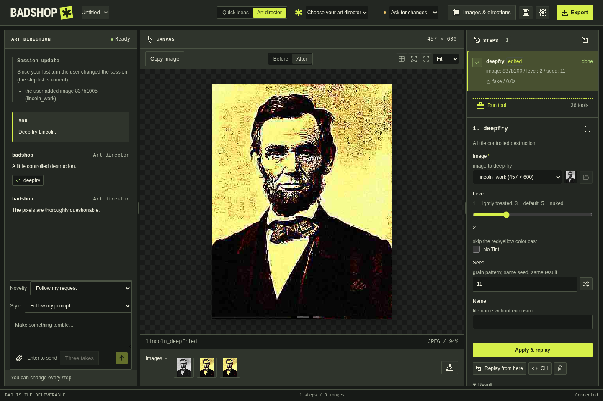
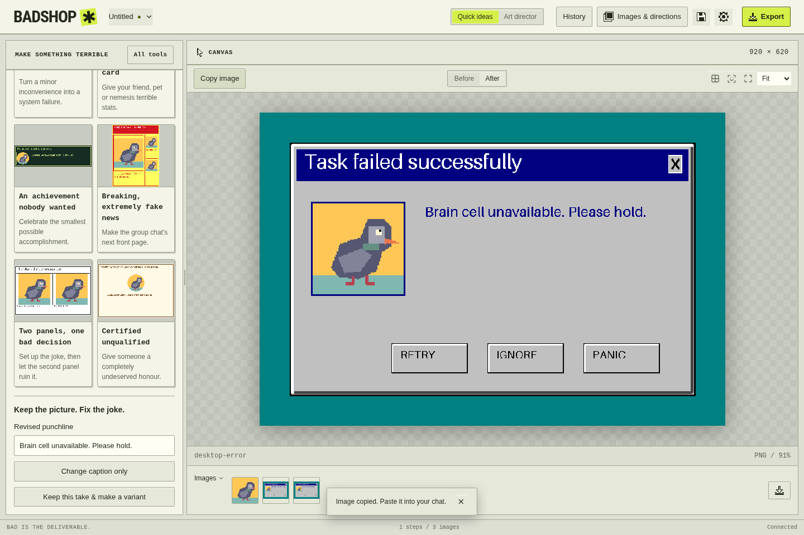
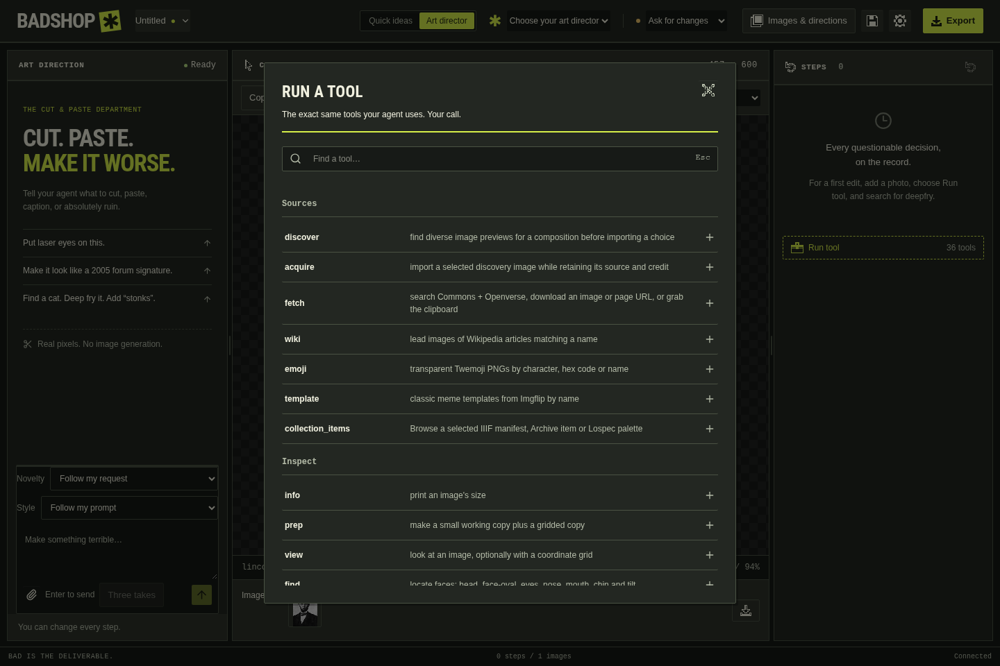
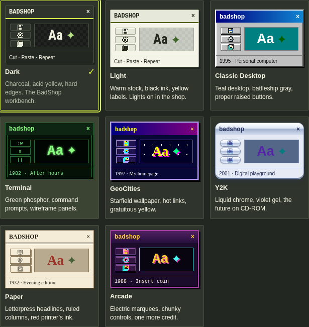

# Screenshot tour

[Documentation](../README.md) · [Quick idea tutorial](../tutorials/first-shitpost.md)

These are real captures of the source interface, not mockups. The browser renders
the same React UI used by the desktop shell. Installed releases may differ.

## The workbench



The left panel holds chat and approvals. The center shows the selected image,
Before/After controls and imported/output thumbnails. The right **Steps** panel
records tool calls and exposes the selected step's parameters. Here, Seed `11`
has been applied and replayed. The header selects a provider and approval policy,
opens settings and exports the selected image.

The conversation is a scripted demonstration. A live model was not contacted;
the image effect, approval, replay and project operations ran through the real core.
Follow [manual editing](../tutorials/edit-and-replay.md) or
[AI art direction](../tutorials/art-director.md) to use these controls.

## Quick ideas



Choose a card, use the bundled pigeon or your own picture, then revise the caption.
**Keep this take & make a variant** preserves a branch for comparison. This capture
shows the completed caption revision and successful clipboard-copy notice.
The [first tutorial](../tutorials/first-shitpost.md) follows this exact example.

## Manual tool palette



**Run tool** opens the shared tool catalogue. Search for a name such as `deepfry`,
choose it, review the input image and parameters, then run it. These are the same
registered tools available to an assistant; manual editing needs no provider.

## Interface themes



**Settings → Preferences** offers these interface themes. This is a capture of
the theme-picker element. Theme changes affect the interface, while artwork pixels
stay unchanged. The [retro workbench guide](../retro-workbench.md) covers the
separate creative styles, palettes and layouts that do affect output.

## Capture notes

Captured 2026-11-12 from source revision
`0986dbda4059bb3ad81d358a71e8126a8e00d684` using Chromium on Arch Linux/WSL.
Full-window captures are 1440 × 960; the theme grid is 615 × 651. PNGs are copied
directly from Playwright output without image-generation or retouching.

The [browser fixtures](../../app/e2e/fixtures.ts) create isolated cores, temporary
settings, output folders and provider scripts, then close their processes and remove
temporary app data. The material is the repository's Lincoln fixture and bundled
CC0 pigeon. No personal projects, credentials or external provider calls are used.

| Published file | Existing capture workflow | What it also checks |
| --- | --- | --- |
| `badshop.png` | [controller.spec.ts](../../app/e2e/controller.spec.ts), `chat, approval, edit, replay, save, open, manual tools and export use the real core` | Approval, parameter editing, replay, project reopening and export |
| `quick-idea.png` | [quick-share.spec.ts](../../app/e2e/quick-share.spec.ts), `a new user makes, revises, copies and exports a credited shitpost without a provider or network` | Caption revision, clipboard pixels, exported bytes/credits and saved-take switching |
| `tools.png`, `themes.png` | [retro.spec.ts](../../app/e2e/retro.spec.ts), `dark interface skin persists and keeps artwork pixels unchanged` | Theme persistence, tool palette and unchanged artwork |

These three selected workflows passed. Logs and `summary.json` are retained in
the task's ignored `artifacts/verification/documentation-captures/` and
`artifacts/verification/documentation-theme/`. They are local evidence, not required
files for reading this documentation. Native file dialogs, packaged installers and
live provider output are outside this capture run.

## Refresh the screenshots

Use an isolated worktree with its own dependencies and the
[development setup](../development.md). From its root on Linux:

```sh
./verify.sh browser --browser-test e2e/controller.spec.ts --test-name "chat, approval, edit, replay" --output artifacts/verification/docs-controller
./verify.sh browser --browser-test e2e/quick-share.spec.ts --test-name "a new user makes" --output artifacts/verification/docs-quick
./verify.sh browser --browser-test e2e/retro.spec.ts --test-name "dark interface skin" --output artifacts/verification/docs-theme
```

On Windows, replace `./verify.sh` with
`uv run --project core --locked python scripts/verify.py`. Each command selects a
single existing workflow. Use fresh output directories for another capture run.

Inspect the PNGs under each output directory's `browser/` subfolders. Copy
`badshop.png` and `quick-idea.png` here; copy `theme-dark-tools.png` as `tools.png`
and `theme-dark-picker.png` as `themes.png`. Check readability and absence of private
data, then update the revision, date, dimensions and captions above. Keep full
verification evidence under `artifacts/verification/`, not in this image folder.
