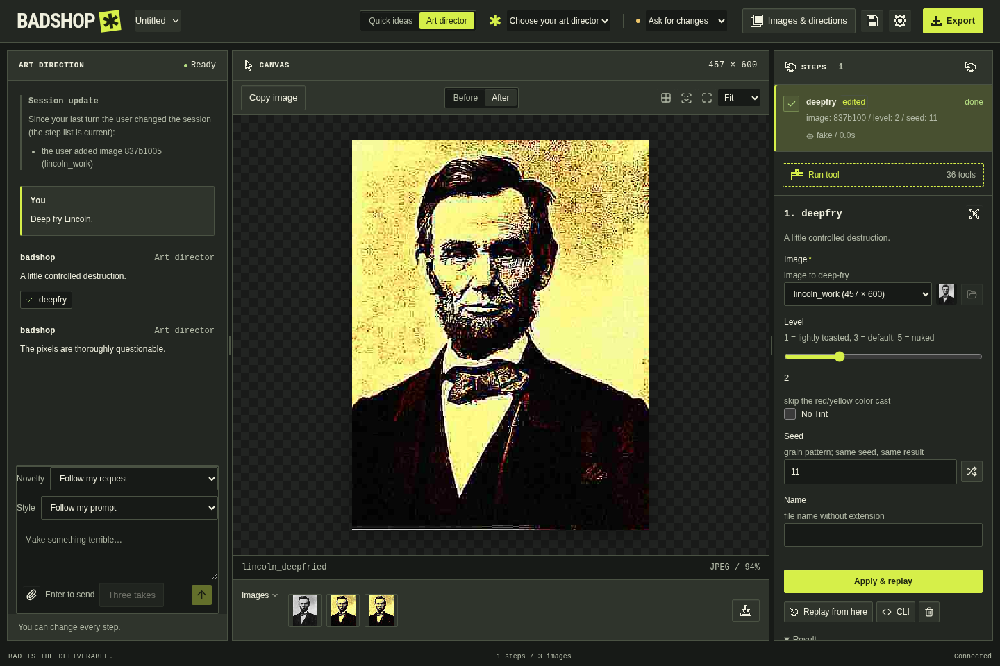

# Manual tools, replay and projects

[Documentation](../README.md) · Previous: [Quick ideas](first-shitpost.md) · Next: [AI art direction](art-director.md)

**Goal:** apply an effect, change an earlier step, and reopen the finished project.
Allow about ten minutes. You need a PNG/JPEG and no AI provider. The
[Quick idea tutorial](first-shitpost.md) also gives you a starting image.

*The screenshot uses a scripted assistant to demonstrate the same timeline.
This tutorial runs the tools manually.*

## 1. Import and select a picture

On first launch, **Edit a photo without AI** opens the workbench. From Quick ideas,
choose **All tools** or **Art director / All tools**. Use **Import images**, or drop
a supported image into the window. Click its thumbnail if it is not already shown
in the viewer.

BadShop retains the original and edits a working copy, normally no larger than
1,000 pixels on its longest side. The viewer dimensions and coordinate grid refer
to the working image. Enlarging an export later cannot restore discarded detail.

## 2. Run an effect twice

1. Click **Run tool**, search for `deepfry`, and select it.
2. Check that **Image** points to the picture you want. The selected image usually
   supplies the default. Leave the other parameters at their defaults.
3. Click **Run tool** in the form. A `deepfry` step should finish with status **done**,
   and its output should appear in the viewer.
4. Select that output, then repeat the same process to add a second `deepfry` step.

The second step uses the first step's output. The **Steps** timeline records both operations,
including their parameters and images. You can select an earlier step to inspect
it without deleting later work.

## 3. Edit the first step and replay

Select the first `deepfry` step in the **Steps** timeline (open **History** if it is
hidden in Quick ideas). In its parameter form, change
**Seed** to `19`, then click **Apply & replay**. Wait until both steps finish.

The first effect is regenerated with that seed. The second step follows the new
output of the first; you do not have to manually replace its image reference.
Select the second step to inspect the final result. **Before** and **After** compare
that step's input and output. **Replay from here** reruns the selected step and
later work using the stored parameters; unchanged deterministic work may be cached.

For corrections you want to inspect before committing, **Preview changes** renders
a draft and **Cancel changes** discards it. The **Manual tools** row under the viewer
also offers crop, resize, rotation, text and other basic edits. See
[manual corrections](../manual-controls.md) for preview limits, effect bypass,
placement controls and source/wording pins.

The coordinate grid is a viewing aid, not a layer burned into the exported image.
For placement tools, use the image-picker controls beside coordinate fields and
use this grid as a reference. See [the screenshot tour](../screenshots/README.md)
for the main panels.

## Save, reopen and export

| Action | Result |
| --- | --- |
| **Ctrl+S / Cmd+S** | Save the current `.badshop` project with editable steps and images |
| **Ctrl+Shift+S / Cmd+Shift+S** | Save a separate project copy |
| **Ctrl+O / Cmd+O** | Reopen a saved project |
| **Export → Save image file** | Write the selected image to the output folder |
| **Copy image** | Put the selected image on the clipboard as PNG |

Save as `my-first-replay.badshop`, close and reopen it, then select the second
step. Confirm that the first step still has Seed `19` and both outputs are present.
Use **Export** to save the result shown in the viewer. If **Before** or an older
step is selected, that is the image you will export. Select **After** on the final
step when you want the final output.

The default output folder is **Pictures → badshop**, configurable in
**Settings → Preferences**. Export creates a unique filename. Format or resize
preparation can create another History result; select the prepared result before
saving it. A copied animation is a still frame; export the animation file to keep
motion. See [sharing formats](../compatibility.md#pictures-and-sharing).

## Recover from a mistake or interruption

- **A tool fails:** select the failed History step and read its message and hint.
  Fix invalid parameters or missing assets before replaying. Earlier completed
  work remains available.
- **A project will not open:** keep the current work and inspect the error. A
  damaged or unsupported project should not replace the active document. Save
  your current work under a separate name before investigating.
- **A save fails:** choose a writable destination and save again; do not treat an
  export or an autosave as your project save.
- **You close with unsaved changes:** choose Save, Discard or Cancel deliberately.
  Cancel keeps the document open. After an unexpected interruption, use the next
  launch's recovery prompt and save the recovered project explicitly.

To explore variations without repeatedly overwriting a timeline, use
[branches in Images & directions](../image-discovery.md). To let a model propose
the same kinds of edits, continue with [Guide an AI art director](art-director.md).
