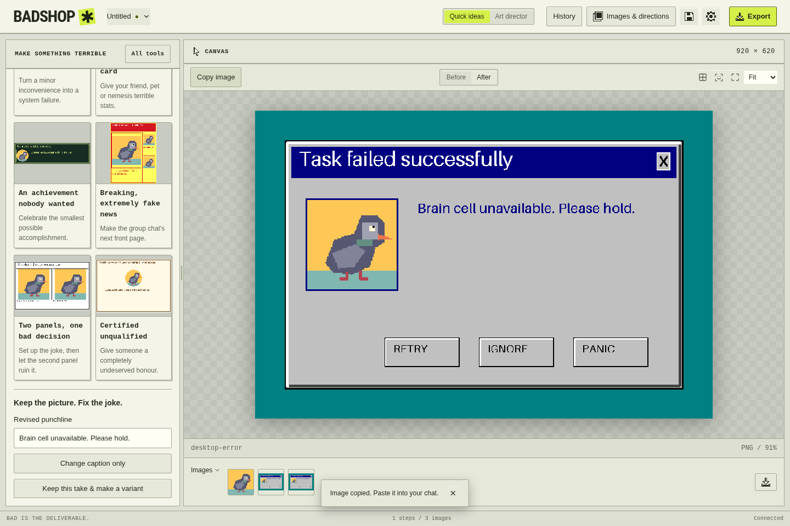

# Make your first Quick idea

[Documentation](../README.md) · Next: [Manual editing and replay](edit-and-replay.md)

**Goal:** make a captioned image, keep an alternate punchline, and save both the
shareable image and the editable project. Allow about five minutes. You need the
installed app or a working source launch. No provider, key or model download is
needed; this example uses the bundled CC0 pigeon.

*Captured from the source UI with a real core and bundled sample. See
[screenshot provenance](../screenshots/README.md#capture-notes).*

## 1. Make the first take

1. On the welcome screen, choose **Start with a quick idea**. If you already have
   the workbench open, click **Quick ideas** in the header.
2. Choose **An error with no solution**. Leave **Picture** set to
   **Use the CC0 pigeon sample**.
3. Keep the suggested **Headline** and enter this **Punchline**:
   `My last brain cell has left the meeting.`
4. Click **Make this shitpost** and wait for the image to appear in the viewer.

You should see the pigeon inside an error-dialog layout and a **Keep the picture.
Fix the joke.** form. The app has created a `layout` step, which you can inspect
later in History. If you prefer your own picture, use **Add my own image**, then
choose the imported picture in **Picture** before making the image.

## 2. Revise without losing the original

Enter `Brain cell unavailable. Please hold.` in **Revised punchline**, then click
**Change caption only**. The layout and chosen picture stay the same while the
caption changes.

Click **Keep this take & make a variant**. Wait for the notice that the original
take was kept before editing the new copy. Change the punchline to
`This pigeon has administrator privileges.` and apply it. Expand **Saved takes**
and choose **Original** to return to the earlier wording.

These takes are editable branches within the project. Making a branch does not
save a project file to disk; save explicitly in the next step.

## 3. Save the project and share the image

1. Press **Ctrl+S** (**Cmd+S** on macOS), choose a location and save
   `pigeon.badshop`. The unsaved-change dot beside the project name clears after
   a successful save. This file keeps the editable steps, images and saved takes.
2. Select the take you want to share and check the viewer. **Copy image** puts a
   PNG on the clipboard for pasting into another app.
3. For a file, click **Export**. Inspect the chat-sized preview, keep the credits
   option enabled if you want source metadata, and click **Save image file**.
   The success notice gives the output path.

The default export folder is **Pictures → badshop**. Change it under
**Settings → Preferences → Output folder**. Repeated exports use separate names
instead of overwriting a prior image. The optional `.credits.json` sidecar records
available attribution; it is not the editable project.

To check your saved work, reopen `pigeon.badshop` with **Ctrl+O** (**Cmd+O**).
The image, layout step and saved takes should still be available. Save again after
later edits; exporting alone does not save the project.

## If a step does not work

| What you see | What to do |
| --- | --- |
| The sample could not be loaded | Use **Add my own image**, select a PNG/JPEG and try again. |
| An image-import error | Convert unsupported formats such as HEIC to PNG/JPEG first; see [supported formats](../compatibility.md#pictures-and-sharing). |
| The caption change fails | Read the error below the form. Open **All tools** for History and the failed step's details; fix the input before retrying. |
| Export fails | Check that **Output folder** exists and is writable. Keep the project open and retry after correcting the path. |
| The app was interrupted | On the next launch, use the offered recovery copy and save it to a named `.badshop` file. |

Once it works, continue with [manual tools and replay](edit-and-replay.md), or
explore [layouts and packs](../layouts-and-packs.md).
